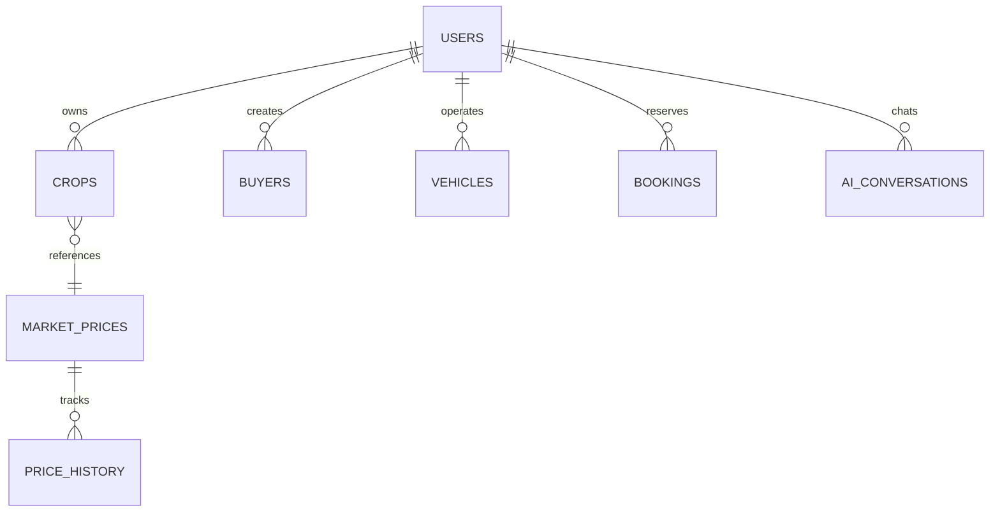

# 🌾 AgriPulse — Smart Crop Forecasting, Agricultural Intelligence & Supply-Chain Platform

[](https://github.com/workamanjadhao-dev/Agripulse-Ai)
[](https://react.dev/)
[](https://vitejs.dev/)
[](https://nodejs.org/)
[](https://www.sqlite.org/)
[](https://tailwindcss.com/)

> **Comprehensive Full-Stack Agricultural Decision-Support Platform**  
> **Official Repository**: [https://github.com/workamanjadhao-dev/Agripulse-Ai](https://github.com/workamanjadhao-dev/Agripulse-Ai)  
> **Live Web Application (Vercel)**: [https://agripulse-ai-wheat.vercel.app](https://agripulse-ai-wheat.vercel.app)  
> **Live REST API (Render)**: [https://agripulse-ai-koxv.onrender.com](https://agripulse-ai-koxv.onrender.com)  
> **System Architecture & Technical Reference Manual**


---

## 📌 1. Project Overview & Problem Statement

### The Problem
Indian farmers face severe price volatility, middleman exploitation, lack of storage awareness, delayed weather risk alerts, and difficulties finding trustworthy buyers and affordable farm machinery rentals. Most existing applications provide either static information or isolated features.

### The Solution: AgriPulse
**AgriPulse** is an integrated full-stack agricultural decision-support ecosystem. It combines:
1. **Real-time APMC Mandi price discovery** across Maharashtra and pan-India.
2. **7, 15, and 30-day econometric crop price forecasting** with an actionable **Hold vs. Sell** recommendation engine.
3. **Direct Farmer-to-Buyer matching** to bypass exploitative intermediaries.
4. **Agri-Logistics & Farm Machinery Sharing** (Tractor, Cold Storage, Harvester, and Transport booking).
5. **Hyperlocal Meteorological Intelligence** with agro-advisories (irrigation triggers, pesticide spray windows, fungal risk alerts).
6. **Multilingual AI Crop Doctor & Advisory Assistant** powered by Google Gemini generative AI.

---

## 💻 2. Complete Technology Stack

| Layer | Technology | Version | Purpose in Project |
| :--- | :--- | :--- | :--- |
| **Frontend Framework** | **React.js** | `18.3.1` | Single Page Application (SPA) component architecture |
| **Build Tool & Bundler** | **Vite** | `6.0.7` | Blazing fast HMR (Hot Module Replacement) and optimized production build |
| **Styling & CSS** | **Tailwind CSS** | `3.4.17` | Utility-first responsive design, modern dark/light aesthetics, glassmorphism |
| **Icons & Visuals** | **Lucide React** | `0.469.0` | Crisp SVG iconography for agricultural & dashboard UI elements |
| **Data Visualization** | **Recharts** | `2.15.0` | Interactive SVG charting for 14-day price trends, arrival curves, and forecasts |
| **Interactive Maps** | **Leaflet & React-Leaflet** | `1.9.4` / `4.2.1` | Geospatial mapping of APMC mandis, cold storages, and rental tractors |
| **Routing** | **React Router DOM** | `6.28.1` | Client-side routing, protected auth routes, dynamic route navigation |
| **Backend Runtime** | **Node.js** | `>=18.0` | Asynchronous event-driven JavaScript server runtime |
| **Backend Framework** | **Express.js** | `4.21.2` | RESTful API server, routing, custom middleware pipeline |
| **Database Engine** | **SQLite3** | `5.1.7` | Serverless, zero-config, ACID-compliant relational SQL database |
| **Authentication & Security**| **JWT + bcryptjs** | `9.0.3` / `3.0.3`| Stateless Bearer token authentication & salted password hashing |
| **Artificial Intelligence** | **Google Gemini SDK** | `@google/generative-ai 0.21.0` | Natural language agricultural advisory & forecast explanations |
| **HTTP Communication** | **Native Fetch API** | ES2022 | Promise-based asynchronous HTTP client across frontend and backend |

---

## 🌐 3. APIs Used & How They Work

### 3.1 External Third-Party APIs

```
                    ┌────────────────────────────────────────┐
                    │            AgriPulse Backend           │
                    │         (Node.js / Express.js)         │
                    └────┬──────────────┬──────────────┬─────┘
                         │              │              │
      HTTPS GET / Live   │              │ Prompt/JSON  │  HTTPS GET / Coords
                         ▼              ▼              ▼
     ┌───────────────────────┐ ┌───────────────┐ ┌───────────────────────┐
     │  data.gov.in / APMC   │ │ Google Gemini │ │   Open-Meteo Weather  │
     │ Agmarknet Portal API  │ │ Flash LLM API │ │   & Nominatim Geocode │
     └───────────────────────┘ └───────────────┘ └───────────────────────┘
```

#### 1. Agmarknet / Open Government Data Platform (`data.gov.in`)
- **Endpoint**: `https://api.data.gov.in/resource/9ef84268-d588-465a-a308-a864a43d0070`
- **Data Extracted**: Commodity, market name, district, state, modal price, min/max price, arrival quantity (quintals), arrival date.
- **How it Works**: The backend service (`marketDataService.js`) polls or syncs data using the Government API key.
- **Fail-safe Grounding Engine**: When the external government portal rate-limits or is offline, AgriPulse automatically activates its **deterministic agricultural simulation engine**. This engine computes live intraday price fluctuations based on Indian Standard Time (IST) trading sessions (Pre-Open sorting, Morning Discovery Auction, Peak Trading, Evening Clearance).

#### 2. Google Gemini Generative AI API (`gemini-1.5-flash` / `gemini-2.0-flash`)
- **Package**: `@google/generative-ai`
- **How it Works**:
  - In `geminiService.js`, the user's question, crop details, soil profile, and current APMC prices are packaged into a structured prompt with system grounding rules.
  - Returns structured forecasts, pest mitigation advisories, and natural language recommendations.
- **Fail-safe Engine**: If no Gemini API key is provided or quota is exceeded, AgriPulse automatically falls back to an **autonomous local knowledge base** that covers 25+ major crops, providing instant diagnostic advice without throwing errors.

#### 3. Open-Meteo Meteorological API (High-Precision Weather)
- **Endpoint**: `https://api.open-meteo.com/v1/forecast`
- **Why Chosen**: 100% free, no API key required, reliable WMO standards, high precision for India.
- **Data Extracted**: Hourly temperature, relative humidity, precipitation probability, wind speed, UV index, cloud cover, and past 14-day cumulative rainfall.
- **Agricultural Advisory Engine**: Transforms raw meteorological metrics into actionable farming alerts:
  - *Irrigation Status*: Holds irrigation if past 14-day rainfall > 60mm or rain probability > 60%.
  - *Pest Risk*: Triggers fungal/bollworm warnings when humidity > 75% and temperature is between 24°C–32°C.
  - *Spray Window*: Warns against pesticide spraying if wind speed > 15 km/h or rain probability > 40%.

#### 4. OpenStreetMap Nominatim & Google Maps Geocoding API
- **Endpoint**: `https://nominatim.openstreetmap.org/reverse`
- **How it Works**: Converts latitude & longitude from the farmer's device GPS into village, district, and APMC market names automatically.

---

### 3.2 Internal REST API Architecture

All internal endpoints are mounted under `http://localhost:5000/api` with full CORS and JSON serialization:

| Endpoint | Method | Middleware / Auth | Description |
| :--- | :---: | :---: | :--- |
| `/api/health` | `GET` | Public | Telemetry status: database connection, sync badge, Gemini status |
| `/api/auth/register` | `POST` | Public | Registers a new user (Farmer, Buyer, Transport Owner, Admin) |
| `/api/auth/login` | `POST` | Public | Verifies credentials with `bcryptjs` and issues signed JWT |
| `/api/auth/me` | `GET` | JWT Bearer | Returns the currently authenticated user's profile |
| `/api/market-prices` | `GET` | Public | Retrieves live APMC prices with search, commodity, and mandi filters |
| `/api/market-prices/history/:crop` | `GET` | Public | Returns 14-day historical price points for trend graphing |
| `/api/market-prices/sync` | `POST` | Admin / System | Manually triggers live Agmarknet / APMC re-sync |
| `/api/crops` | `GET, POST` | JWT Bearer | Lists all crops or adds a new active crop for the logged-in farmer |
| `/api/crops/:id` | `PUT, DELETE` | JWT Bearer | Updates or removes a farmer's crop record |
| `/api/forecast` | `GET` | Public | Returns quantitative 7/15/30-day econometric forecasts |
| `/api/ai/forecast` | `POST` | Public / Key | Generates AI-explained forecast report with Hold/Sell advice |
| `/api/ai/chat` | `POST` | Public / Key | Crop doctor chatbot answering farmer queries in multiple languages |
| `/api/buyers` | `GET, POST` | Public / JWT | Fetches buyer bulk procurement requirements or posts a new demand |
| `/api/matches` | `GET` | JWT Bearer | Algorithmic matching between farmer produce and active buyer demand |
| `/api/warehouses` | `GET, POST` | Public | Searches available cold storage facilities by crop and distance |
| `/api/vehicles` | `GET, POST` | Public | Lists agricultural transport vehicles with rates per kilometer |
| `/api/rentals/tractors` | `GET, POST` | Public | Tractors & harvesting equipment catalog for rentals |
| `/api/bookings` | `GET, POST` | JWT Bearer | Manages equipment, cold storage, and transport reservations |
| `/api/price-alerts` | `GET, POST` | Public | Configures SMS/email threshold alerts for price spikes |
| `/api/weather` | `GET` | Public | Returns real-time weather and 14-day past rainfall for GPS/district |

---

## 🗄️ 4. Data Storage: Where & How Actual Data is Stored

### 4.1 Server-Side Database (Persistent Disk Storage)

> 📍 **Exact File Location**:  
> `server/database.sqlite` (Relative to project root: `e:/Final Year Project/server/database.sqlite`)

- **Format**: SQLite 3 single-file relational database.
- **Engine**: Node.js `sqlite3` driver wrapped in asynchronous Promise helpers (`dbRun`, `dbGet`, `dbAll`).
- **Data Integrity**: Enforces `PRAGMA foreign_keys = ON;` on every connection. All transactions and relational cascades are enforced.
- **Architectural Rationale for SQLite**: 
  1. **Zero configuration**: No local daemon or server installation (like MySQL/PostgreSQL) required to get started immediately.
  2. **100% Portable**: The database file moves with the project code for easy deployments and backups.
  3. **ACID Compliant**: Complete Atomicity, Consistency, Isolation, and Durability.

```
Final Year Project/
├── server/
│   ├── database/
│   │   ├── db.js             <-- SQLite Connection, PRAGMA config & Async Helpers
│   │   └── schema.js         <-- Table Schemas, Alter Migrations & Baseline Seeds
│   └── database.sqlite       <-- ★ ACTUAL PHYSICAL DATA FILE (~770 KB)
```

---

### 4.2 Database Schema & Entity Relational Tables



#### Detailed Table Specifications

1. **`users` Table** (Core authentication and user profiles):
   - `id` (TEXT, PK): UUID format (`usr-xxxx`).
   - `name`, `email` (UNIQUE), `password` (bcrypt salted hash), `role` (`farmer`, `buyer`, `transporter`, `admin`).
   - Profile columns: `phone`, `location`, `farm_land`, `farm_size_acres`, `soil_type`, `primary_commodities`, `business_name`, `default_mandi`.

2. **`crops` Table** (Farmer's current standing and stored crops):
   - `id` (TEXT, PK): Unique crop ID (`crop-xxxx`).
   - `farmer_id` (TEXT, FK -> `users.id`): Owner link.
   - `crop_name`, `quantity` (REAL), `unit` (`Quintal`, `Ton`, `Kg`), `location`.
   - `sowing_date`, `expected_harvest_date`, `stage` (`Sowing`, `Vegetative Growth`, `Flowering`, `Harvesting`).
   - `progress_percent`, `health_status` (`Good`, `Moderate`, `Critical`), `expected_yield_quintals`.

3. **`market_prices` Table** (Normalized daily APMC mandi rates):
   - `id` (INTEGER, PK, AUTOINCREMENT).
   - `crop_name`, `commodity`, `market`, `location`, `state`, `district`.
   - `price`, `modalPrice`, `minPrice`, `maxPrice`, `arrivalQuantity` (REAL).
   - Real-time columns: `change`, `changePercent`, `trend` (`up`, `down`, `stable`), `marketStatus`, `sessionName`.
   - Constraint: `UNIQUE(crop_name, market, date)`.

4. **`price_history` Table** (14-day historical time-series for Recharts visualization):
   - `id` (INTEGER, PK, AUTOINCREMENT).
   - `commodity`, `market`, `state`, `district`, `modalPrice`, `minPrice`, `maxPrice`, `arrivalQuantity`, `date`.

5. **`buyers` Table** (Wholesale and direct buyer requirements):
   - `id` (TEXT, PK), `user_id` (TEXT, FK), `business_name`, `crop_required`, `quantity_required`, `price_offered`, `location`, `contact_phone`, `status`.

6. **`warehouses` Table** (Cold storages & dry warehouses):
   - `id` (TEXT, PK), `name`, `location`, `latitude`, `longitude`, `capacity`, `available_capacity`, `supported_crops`, `price_per_quintal_month`, `temp_range`, `rating`.

7. **`vehicles` Table** (Logistics & farm transport fleet):
   - `id` (TEXT, PK), `owner_id` (TEXT, FK), `vehicle_type` (Pickup, 3-Ton, 10-Ton Truck), `vehicle_name`, `location`, `capacity`, `rate_per_km`, `availability`, `driver_name`, `driver_phone`.

8. **`bookings` Table** (Equipment, tractor, and storage reservations):
   - `id` (TEXT, PK), `user_id` (TEXT, FK), `resourceId`, `item`, `type` (`Tractor`, `Warehouse`, `Transport`), `startDate`, `endDate`, `price`, `status` (`Upcoming`, `Active`, `Completed`, `Cancelled`).

9. **`forecasts` Table** (Pre-computed multi-factor econometric forecasts):
   - `id` (INTEGER, PK), `crop_name`, `market`, `current_price`, `forecast_7_day`, `forecast_15_day`, `forecast_30_day`, `trend`, `confidence`, `factors`.

10. **`ai_conversations` Table** (Persisted chat logs):
    - `id` (INTEGER, PK), `user_id` (TEXT, FK), `message`, `response`, `source` (`Gemini AI` or `Local Grounded Engine`), `created_at`.

11. **`data_sync_logs` Table** (Telemetry and background job audit trail):
    - `id` (INTEGER, PK), `source`, `status`, `records_fetched`, `error_message`, `sync_timestamp`.

---

### 4.3 Client-Side Storage (Browser `localStorage`)

The frontend persists session and UI preferences directly in the browser's storage:
- `agri_jwt_token`: Stores the signed JSON Web Token returned by `/api/auth/login` to authorize future API requests via the `Authorization: Bearer <token>` header.
- `agri_gemini_api_key`: Optional user-specified Gemini API key override entered in the UI.
- `agri_user`: Cached profile metadata for instant UI rendering on reload.

---

## 📈 5. Quantitative Forecasting & AI Decision Engine

### How the Forecasting Model Computes Future Prices:
The project uses a **multi-factor econometric mathematical model** (`quantitativeForecastingEngine.js`) combined with generative explanations from Gemini:

$$\text{Forecast Price} = P_{\text{current}} \times (1 + \Delta_{\text{trend}} + \Delta_{\text{seasonal}} + \Delta_{\text{elasticity}} + \Delta_{\text{macro}})$$

1. **Seasonal Harmonic Component**: Analyzes historical seasonal harvesting cycles across Kharif, Rabi, and Zaid crops using harmonic sine/cosine curves based on the day of the year.
2. **Arrival Elasticity**: Models supply-demand dynamics ($E = \frac{\% \Delta \text{Price}}{\% \Delta \text{Arrival}}$). High APMC arrivals suppress spot rates, while restricted arrivals trigger price surges.
3. **Historical Moving Average Momentum**: Exponential Moving Average (EMA-7 and EMA-14) computed from the `price_history` table.
4. **Hold vs. Sell Recommendation Logic**:
   - If projected price gain in 15 days exceeds storage costs (₹80/quintal/month) by $> 5\%$, the system advises: **"HOLD: Expecting price rise"**.
   - If arrival pressure or weather risks predict price depreciation, the system advises: **"SELL NOW: Maximize spot return"**.

---

## 🚀 6. Step-by-Step Instructions to Run the Project for Viva / Evaluation

### Prerequisites
- **Git** installed on the system
- **Node.js** (`>= v18.0.0`) installed on the machine
- Web browser (Google Chrome, Microsoft Edge, or Brave)

### Step 0: Clone the Repository
```bash
git clone https://github.com/workamanjadhao-dev/Agripulse-Ai.git
cd Agripulse-Ai
```

### Step 1: Start the Backend Server
Open Terminal 1:
```bash
cd "server"
npm install
npm run dev
```
- Server starts at: **`http://localhost:5000`**
- Automatically initializes and verifies `database.sqlite`.

### Step 2: Start the Frontend Application
Open Terminal 2:
```bash
cd ".."
npm install
npm run dev
```
- Frontend starts at: **`http://localhost:5173`** (or the port Vite outputs).

### Step 3: Open in Browser & Demo
Navigate to `http://localhost:5173`.

#### Pre-configured Demo Accounts:
| Role | Email | Password | Primary Capabilities |
| :--- | :--- | :--- | :--- |
| **Farmer** | `farmer@agripulse.in` | `farmer123` | My Crops, Mandi Discovery, Hold vs Sell, AI Chatbot |
| **Buyer / Trader** | `trader@vidarbhaagro.com` | `buyer123` | Post Requirement, Direct Farmer Match, Wholesale Procurement |
| **Fleet / Transporter** | `fleet@agripulse.in` | `owner123` | Fleet Management, Rental Bookings, Route Dispatch |
| **Administrator** | `admin@agripulse.in` | `admin123` | APMC Sync Controls, Health Telemetry, User & Resource Overview |


---

## 🌟 7. Core Feature Modules

### 1. 📊 Real-Time Mandi Price Discovery
- Live modal, minimum, and maximum prices for 25+ essential Indian commodities.
- Multi-filter search by crop name, mandi, district, and state.
- 14-day interactive price and arrival volume trends rendered with Recharts.
- Intraday simulated trading sessions aligned with Indian Standard Time (IST).

### 2. 🔮 Econometric Crop Price Forecasting & Decision Engine
- 7, 15, and 30-day projection curves powered by quantitative harmonic price modeling.
- Evaluates harvest arrival volume elasticity, seasonal factors, and moving averages.
- **Hold vs. Sell Advisor**: Computes net profit after cold storage expense (₹80/quintal/month) and advises whether to sell immediately or store for future gain.

### 3. 🤝 Direct Farmer-Buyer Marketplace
- Algorithmic matching between farmer crop listings and buyer procurement demand.
- Match score based on commodity compatibility, required quantity, and price expectation.
- Direct contact bridge to bypass commission agents and exploitative middlemen.

### 4. 🚜 Agri-Logistics & Farm Machinery Sharing
- **Tractor & Harvester Rental**: Search and book nearby tractors and farming implements with transparent hourly/daily pricing.
- **Cold Storage Finder**: Discover certified warehouses and cold storages by commodity, temperature range, and proximity.
- **Transport Fleet Dispatch**: Agricultural vehicle booking with clear per-kilometer freight pricing.

### 5. 🌦️ Hyperlocal Weather & Agro-Advisories
- High-precision live weather and 7-day forecast via Open-Meteo.
- 14-day past rainfall monitoring.
- Actionable rule-based farming advisories:
  - **Irrigation Advice**: Pause watering when recent rain or precipitation probability is elevated.
  - **Pest & Disease Alert**: Early warnings for fungal infections and bollworms based on temperature/humidity thresholds.
  - **Pesticide Spray Window**: Alerts against spraying during high wind speeds or imminent rainfall.

### 6. 🤖 Multilingual AI Crop Doctor
- Conversational agricultural advisor powered by Google Gemini generative AI.
- Multi-turn advice for crop disease symptoms, soil nutrient management, and pesticide dosages.
- Autonomous offline knowledge fallback ensuring 100% uptime even without external AI keys.

---

## ⚙️ 8. Environment Variables & Configuration

Create a `.env` file inside the `server/` directory using the provided `.env.example`:

```bash
# Server Port
PORT=5000

# Security (JWT secret for session tokens)
JWT_SECRET=your_super_secret_jwt_key_here

# Google Gemini API Key (Optional: for live generative AI assistant)
GEMINI_API_KEY=your_gemini_api_key_here

# Open Government Data (data.gov.in) API Key (Optional)
DATA_GOV_IN_API_KEY=your_government_portal_api_key_here
```

> **Note**: AgriPulse is built to be fully functional out-of-the-box. If external API keys are omitted, the platform gracefully switches to built-in simulation and local knowledge bases.

---

## 🗺️ 9. Future Roadmap & Enhancements

- [ ] **IoT Sensor Integration**: Real-time soil moisture and NPK sensor telemetry over MQTT.
- [ ] **Vernacular Voice Interface**: Speech-to-text queries in Marathi, Hindi, and Telugu.
- [ ] **UPI Escrow Payment Gateway**: Secure digital advance payment for equipment rentals and produce transactions.
- [ ] **Satellite NDVI Health Indices**: Remote sensing crop health analysis through Sentinel/Copernicus satellite imagery.

---

## 👨‍💻 Project Author & Contributors
- **Lead Developer**: **Aman Jadhao** ([@workamanjadhao-dev](https://github.com/workamanjadhao-dev))
- **Contact / Email**: [work.amanjadhao@gmail.com](mailto:work.amanjadhao@gmail.com)
- **Repository**: [https://github.com/workamanjadhao-dev/Agripulse-Ai](https://github.com/workamanjadhao-dev/Agripulse-Ai)
- **Academic Department**: Final Year Engineering / Computer Science Department
- **Project Academic Year**: 2025 – 2026
- **Status**: Tested, Functional & Ready for Evaluation / Deployment

