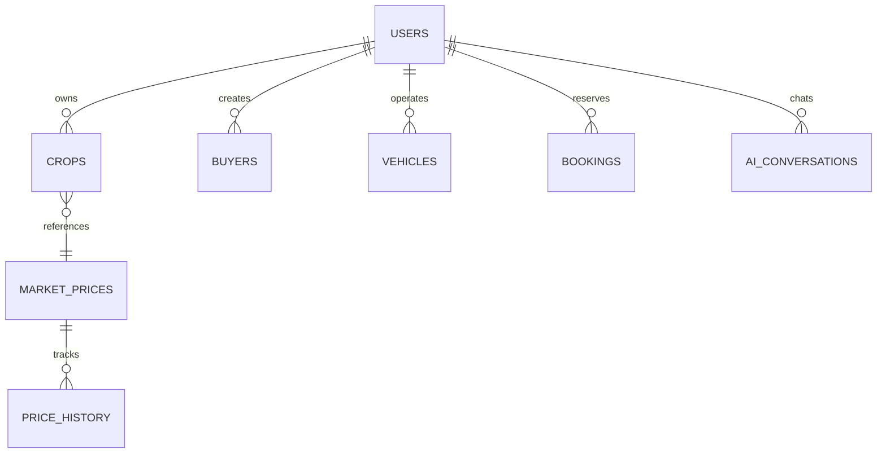

# 🌾 AgriPulse — Smart Crop Forecasting, Agricultural Intelligence & Supply-Chain Platform

[](https://github.com/workamanjadhao-dev/Agripulse-Ai)
[](https://react.dev/)
[](https://vitejs.dev/)
[](https://nodejs.org/)
[](https://www.sqlite.org/)
[](https://tailwindcss.com/)

> **Final Year Project (Capstone / B.Tech / B.E. / MCA)**  
> **Official Repository**: [https://github.com/workamanjadhao-dev/Agripulse-Ai](https://github.com/workamanjadhao-dev/Agripulse-Ai)  
> **Comprehensive System Documentation & Viva-Defense Reference Manual**

---

## 📌 1. Project Overview & Problem Statement

### The Problem
Indian farmers face severe price volatility, middleman exploitation, lack of storage awareness, delayed weather risk alerts, and difficulties finding trustworthy buyers and affordable farm machinery rentals. Most existing applications provide either static information or isolated features.

### The Solution: AgriPulse
**AgriPulse** is an integrated full-stack agricultural decision-support ecosystem. It combines:
1. **Real-time APMC Mandi price discovery** across Maharashtra and pan-India.
2. **7, 15, and 30-day econometric crop price forecasting** with an actionable **Hold vs. Sell** recommendation engine.
3. **Direct Farmer-to-Buyer matching** to bypass exploitative intermediaries.
4. **Agri-Logistics & Farm Machinery Sharing** (Tractor, Cold Storage, Harvester, and Transport booking).
5. **Hyperlocal Meteorological Intelligence** with agro-advisories (irrigation triggers, pesticide spray windows, fungal risk alerts).
6. **Multilingual AI Crop Doctor & Advisory Assistant** powered by Google Gemini generative AI.

---

## 💻 2. Complete Technology Stack

| Layer | Technology | Version | Purpose in Project |
| :--- | :--- | :--- | :--- |
| **Frontend Framework** | **React.js** | `18.3.1` | Single Page Application (SPA) component architecture |
| **Build Tool & Bundler** | **Vite** | `6.0.7` | Blazing fast HMR (Hot Module Replacement) and optimized production build |
| **Styling & CSS** | **Tailwind CSS** | `3.4.17` | Utility-first responsive design, modern dark/light aesthetics, glassmorphism |
| **Icons & Visuals** | **Lucide React** | `0.469.0` | Crisp SVG iconography for agricultural & dashboard UI elements |
| **Data Visualization** | **Recharts** | `2.15.0` | Interactive SVG charting for 14-day price trends, arrival curves, and forecasts |
| **Interactive Maps** | **Leaflet & React-Leaflet** | `1.9.4` / `4.2.1` | Geospatial mapping of APMC mandis, cold storages, and rental tractors |
| **Routing** | **React Router DOM** | `6.28.1` | Client-side routing, protected auth routes, dynamic route navigation |
| **Backend Runtime** | **Node.js** | `>=18.0` | Asynchronous event-driven JavaScript server runtime |
| **Backend Framework** | **Express.js** | `4.21.2` | RESTful API server, routing, custom middleware pipeline |
| **Database Engine** | **SQLite3** | `5.1.7` | Serverless, zero-config, ACID-compliant relational SQL database |
| **Authentication & Security**| **JWT + bcryptjs** | `9.0.3` / `3.0.3`| Stateless Bearer token authentication & salted password hashing |
| **Artificial Intelligence** | **Google Gemini SDK** | `@google/generative-ai 0.21.0` | Natural language agricultural advisory & forecast explanations |
| **HTTP Communication** | **Native Fetch API** | ES2022 | Promise-based asynchronous HTTP client across frontend and backend |

---

## 🌐 3. APIs Used & How They Work

### 3.1 External Third-Party APIs

```
                    ┌────────────────────────────────────────┐
                    │            AgriPulse Backend           │
                    │         (Node.js / Express.js)         │
                    └────┬──────────────┬──────────────┬─────┘
                         │              │              │
      HTTPS GET / Live   │              │ Prompt/JSON  │  HTTPS GET / Coords
                         ▼              ▼              ▼
     ┌───────────────────────┐ ┌───────────────┐ ┌───────────────────────┐
     │  data.gov.in / APMC   │ │ Google Gemini │ │   Open-Meteo Weather  │
     │ Agmarknet Portal API  │ │ Flash LLM API │ │   & Nominatim Geocode │
     └───────────────────────┘ └───────────────┘ └───────────────────────┘
```

#### 1. Agmarknet / Open Government Data Platform (`data.gov.in`)
- **Endpoint**: `https://api.data.gov.in/resource/9ef84268-d588-465a-a308-a864a43d0070`
- **Data Extracted**: Commodity, market name, district, state, modal price, min/max price, arrival quantity (quintals), arrival date.
- **How it Works**: The backend service (`marketDataService.js`) polls or syncs data using the Government API key.
- **Viva Defense Point (Fail-safe Grounding Engine)**: When the external government portal rate-limits or is offline, AgriPulse automatically activates its **deterministic agricultural simulation engine**. This engine computes live intraday price fluctuations based on Indian Standard Time (IST) trading sessions (Pre-Open sorting, Morning Discovery Auction, Peak Trading, Evening Clearance).

#### 2. Google Gemini Generative AI API (`gemini-1.5-flash` / `gemini-2.0-flash`)
- **Package**: `@google/generative-ai`
- **How it Works**:
  - In `geminiService.js`, the user's question, crop details, soil profile, and current APMC prices are packaged into a structured prompt with system grounding rules.
  - Returns structured forecasts, pest mitigation advisories, and natural language recommendations.
- **Fail-safe Engine**: If no Gemini API key is provided or quota is exceeded, AgriPulse automatically falls back to an **autonomous local knowledge base** that covers 25+ major crops, providing instant diagnostic advice without throwing errors.

#### 3. Open-Meteo Meteorological API (High-Precision Weather)
- **Endpoint**: `https://api.open-meteo.com/v1/forecast`
- **Why Chosen**: 100% free, no API key required, reliable WMO standards, high precision for India.
- **Data Extracted**: Hourly temperature, relative humidity, precipitation probability, wind speed, UV index, cloud cover, and past 14-day cumulative rainfall.
- **Agricultural Advisory Engine**: Transforms raw meteorological metrics into actionable farming alerts:
  - *Irrigation Status*: Holds irrigation if past 14-day rainfall > 60mm or rain probability > 60%.
  - *Pest Risk*: Triggers fungal/bollworm warnings when humidity > 75% and temperature is between 24°C–32°C.
  - *Spray Window*: Warns against pesticide spraying if wind speed > 15 km/h or rain probability > 40%.

#### 4. OpenStreetMap Nominatim & Google Maps Geocoding API
- **Endpoint**: `https://nominatim.openstreetmap.org/reverse`
- **How it Works**: Converts latitude & longitude from the farmer's device GPS into village, district, and APMC market names automatically.

---

### 3.2 Internal REST API Architecture

All internal endpoints are mounted under `http://localhost:5000/api` with full CORS and JSON serialization:

| Endpoint | Method | Middleware / Auth | Description |
| :--- | :---: | :---: | :--- |
| `/api/health` | `GET` | Public | Telemetry status: database connection, sync badge, Gemini status |
| `/api/auth/register` | `POST` | Public | Registers a new user (Farmer, Buyer, Transport Owner, Admin) |
| `/api/auth/login` | `POST` | Public | Verifies credentials with `bcryptjs` and issues signed JWT |
| `/api/auth/me` | `GET` | JWT Bearer | Returns the currently authenticated user's profile |
| `/api/market-prices` | `GET` | Public | Retrieves live APMC prices with search, commodity, and mandi filters |
| `/api/market-prices/history/:crop` | `GET` | Public | Returns 14-day historical price points for trend graphing |
| `/api/market-prices/sync` | `POST` | Admin / System | Manually triggers live Agmarknet / APMC re-sync |
| `/api/crops` | `GET, POST` | JWT Bearer | Lists all crops or adds a new active crop for the logged-in farmer |
| `/api/crops/:id` | `PUT, DELETE` | JWT Bearer | Updates or removes a farmer's crop record |
| `/api/forecast` | `GET` | Public | Returns quantitative 7/15/30-day econometric forecasts |
| `/api/ai/forecast` | `POST` | Public / Key | Generates AI-explained forecast report with Hold/Sell advice |
| `/api/ai/chat` | `POST` | Public / Key | Crop doctor chatbot answering farmer queries in multiple languages |
| `/api/buyers` | `GET, POST` | Public / JWT | Fetches buyer bulk procurement requirements or posts a new demand |
| `/api/matches` | `GET` | JWT Bearer | Algorithmic matching between farmer produce and active buyer demand |
| `/api/warehouses` | `GET, POST` | Public | Searches available cold storage facilities by crop and distance |
| `/api/vehicles` | `GET, POST` | Public | Lists agricultural transport vehicles with rates per kilometer |
| `/api/rentals/tractors` | `GET, POST` | Public | Tractors & harvesting equipment catalog for rentals |
| `/api/bookings` | `GET, POST` | JWT Bearer | Manages equipment, cold storage, and transport reservations |
| `/api/price-alerts` | `GET, POST` | Public | Configures SMS/email threshold alerts for price spikes |
| `/api/weather` | `GET` | Public | Returns real-time weather and 14-day past rainfall for GPS/district |

---

## 🗄️ 4. Data Storage: Where & How Actual Data is Stored

### 4.1 Server-Side Database (Persistent Disk Storage)

> 📍 **Exact File Location**:  
> `server/database.sqlite` (Relative to project root: `e:/Final Year Project/server/database.sqlite`)

- **Format**: SQLite 3 single-file relational database.
- **Engine**: Node.js `sqlite3` driver wrapped in asynchronous Promise helpers (`dbRun`, `dbGet`, `dbAll`).
- **Data Integrity**: Enforces `PRAGMA foreign_keys = ON;` on every connection. All transactions and relational cascades are enforced.
- **Why SQLite for Viva**: 
  1. **Zero configuration**: No local server installation (like MySQL/PostgreSQL service) is needed on the evaluator's computer.
  2. **100% Portable**: The database file moves with the project code.
  3. **ACID Compliant**: Complete Atomicity, Consistency, Isolation, and Durability.

```
Final Year Project/
├── server/
│   ├── database/
│   │   ├── db.js             <-- SQLite Connection, PRAGMA config & Async Helpers
│   │   └── schema.js         <-- Table Schemas, Alter Migrations & Baseline Seeds
│   └── database.sqlite       <-- ★ ACTUAL PHYSICAL DATA FILE (~770 KB)
```

---

### 4.2 Database Schema & Entity Relational Tables



#### Detailed Table Specifications

1. **`users` Table** (Core authentication and user profiles):
   - `id` (TEXT, PK): UUID format (`usr-xxxx`).
   - `name`, `email` (UNIQUE), `password` (bcrypt salted hash), `role` (`farmer`, `buyer`, `transporter`, `admin`).
   - Profile columns: `phone`, `location`, `farm_land`, `farm_size_acres`, `soil_type`, `primary_commodities`, `business_name`, `default_mandi`.

2. **`crops` Table** (Farmer's current standing and stored crops):
   - `id` (TEXT, PK): Unique crop ID (`crop-xxxx`).
   - `farmer_id` (TEXT, FK -> `users.id`): Owner link.
   - `crop_name`, `quantity` (REAL), `unit` (`Quintal`, `Ton`, `Kg`), `location`.
   - `sowing_date`, `expected_harvest_date`, `stage` (`Sowing`, `Vegetative Growth`, `Flowering`, `Harvesting`).
   - `progress_percent`, `health_status` (`Good`, `Moderate`, `Critical`), `expected_yield_quintals`.

3. **`market_prices` Table** (Normalized daily APMC mandi rates):
   - `id` (INTEGER, PK, AUTOINCREMENT).
   - `crop_name`, `commodity`, `market`, `location`, `state`, `district`.
   - `price`, `modalPrice`, `minPrice`, `maxPrice`, `arrivalQuantity` (REAL).
   - Real-time columns: `change`, `changePercent`, `trend` (`up`, `down`, `stable`), `marketStatus`, `sessionName`.
   - Constraint: `UNIQUE(crop_name, market, date)`.

4. **`price_history` Table** (14-day historical time-series for Recharts visualization):
   - `id` (INTEGER, PK, AUTOINCREMENT).
   - `commodity`, `market`, `state`, `district`, `modalPrice`, `minPrice`, `maxPrice`, `arrivalQuantity`, `date`.

5. **`buyers` Table** (Wholesale and direct buyer requirements):
   - `id` (TEXT, PK), `user_id` (TEXT, FK), `business_name`, `crop_required`, `quantity_required`, `price_offered`, `location`, `contact_phone`, `status`.

6. **`warehouses` Table** (Cold storages & dry warehouses):
   - `id` (TEXT, PK), `name`, `location`, `latitude`, `longitude`, `capacity`, `available_capacity`, `supported_crops`, `price_per_quintal_month`, `temp_range`, `rating`.

7. **`vehicles` Table** (Logistics & farm transport fleet):
   - `id` (TEXT, PK), `owner_id` (TEXT, FK), `vehicle_type` (Pickup, 3-Ton, 10-Ton Truck), `vehicle_name`, `location`, `capacity`, `rate_per_km`, `availability`, `driver_name`, `driver_phone`.

8. **`bookings` Table** (Equipment, tractor, and storage reservations):
   - `id` (TEXT, PK), `user_id` (TEXT, FK), `resourceId`, `item`, `type` (`Tractor`, `Warehouse`, `Transport`), `startDate`, `endDate`, `price`, `status` (`Upcoming`, `Active`, `Completed`, `Cancelled`).

9. **`forecasts` Table** (Pre-computed multi-factor econometric forecasts):
   - `id` (INTEGER, PK), `crop_name`, `market`, `current_price`, `forecast_7_day`, `forecast_15_day`, `forecast_30_day`, `trend`, `confidence`, `factors`.

10. **`ai_conversations` Table** (Persisted chat logs):
    - `id` (INTEGER, PK), `user_id` (TEXT, FK), `message`, `response`, `source` (`Gemini AI` or `Local Grounded Engine`), `created_at`.

11. **`data_sync_logs` Table** (Telemetry and background job audit trail):
    - `id` (INTEGER, PK), `source`, `status`, `records_fetched`, `error_message`, `sync_timestamp`.

---

### 4.3 Client-Side Storage (Browser `localStorage`)

The frontend persists session and UI preferences directly in the browser's storage:
- `agri_jwt_token`: Stores the signed JSON Web Token returned by `/api/auth/login` to authorize future API requests via the `Authorization: Bearer <token>` header.
- `agri_gemini_api_key`: Optional user-specified Gemini API key override entered in the UI.
- `agri_user`: Cached profile metadata for instant UI rendering on reload.

---

## 📈 5. Quantitative Forecasting & AI Decision Engine

### How the Forecasting Model Computes Future Prices:
The project uses a **multi-factor econometric mathematical model** (`quantitativeForecastingEngine.js`) combined with generative explanations from Gemini:

$$\text{Forecast Price} = P_{\text{current}} \times (1 + \Delta_{\text{trend}} + \Delta_{\text{seasonal}} + \Delta_{\text{elasticity}} + \Delta_{\text{macro}})$$

1. **Seasonal Harmonic Component**: Analyzes historical seasonal harvesting cycles across Kharif, Rabi, and Zaid crops using harmonic sine/cosine curves based on the day of the year.
2. **Arrival Elasticity**: Models supply-demand dynamics ($E = \frac{\% \Delta \text{Price}}{\% \Delta \text{Arrival}}$). High APMC arrivals suppress spot rates, while restricted arrivals trigger price surges.
3. **Historical Moving Average Momentum**: Exponential Moving Average (EMA-7 and EMA-14) computed from the `price_history` table.
4. **Hold vs. Sell Recommendation Logic**:
   - If projected price gain in 15 days exceeds storage costs (₹80/quintal/month) by $> 5\%$, the system advises: **"HOLD: Expecting price rise"**.
   - If arrival pressure or weather risks predict price depreciation, the system advises: **"SELL NOW: Maximize spot return"**.

---

## 🚀 6. Step-by-Step Instructions to Run the Project for Viva / Evaluation

### Prerequisites
- **Git** installed on the system
- **Node.js** (`>= v18.0.0`) installed on the machine
- Web browser (Google Chrome, Microsoft Edge, or Brave)

### Step 0: Clone the Repository
```bash
git clone https://github.com/workamanjadhao-dev/Agripulse-Ai.git
cd Agripulse-Ai
```

### Step 1: Start the Backend Server
Open Terminal 1:
```bash
cd "server"
npm install
npm run dev
```
- Server starts at: **`http://localhost:5000`**
- Automatically initializes and verifies `database.sqlite`.

### Step 2: Start the Frontend Application
Open Terminal 2:
```bash
cd ".."
npm install
npm run dev
```
- Frontend starts at: **`http://localhost:5173`** (or the port Vite outputs).

### Step 3: Open in Browser & Demo
Navigate to `http://localhost:5173`.

#### Pre-configured Demo Accounts for Instant Viva Presentation:
| Role | Email | Password | What to Showcase |
| :--- | :--- | :--- | :--- |
| **Farmer** | `farmer@demo.com` | `farmer123` | My Crops, Mandi Discovery, Hold vs Sell, AI Chatbot |
| **Buyer / Trader** | `buyer@demo.com` | `buyer123` | Post Requirement, Direct Farmer Match, Wholesale Procurement |
| **Transporter** | `transporter@demo.com` | `trans123` | Fleet Management, Rental Bookings, Route Dispatch |
| **Administrator** | `admin@demo.com` | `admin123` | APMC Sync Controls, Health Telemetry, User & Resource Overview |

---

## 🎯 7. Top 15 Viva Questions & Technical Answers (Viva Cheat Sheet)

#### Q1: "Where is the data stored in your project?"
> **Answer**:  
> "All transactional and market data is persistently stored in a local relational database file named `database.sqlite` located inside the `/server` directory. It uses the `sqlite3` engine with enforced foreign key constraints (`PRAGMA foreign_keys = ON`). Session tokens are stored in the client's `localStorage`."

#### Q2: "Why did you choose SQLite over MongoDB or MySQL?"
> **Answer**:  
> "First, agricultural data (crops, farmers, APMC prices, bookings) is inherently relational, requiring strict ACID compliance and foreign-key integrity. Second, SQLite is serverless and zero-configuration, meaning the complete database resides in a single portable binary file (`database.sqlite`) that runs identically on any demonstration machine without requiring a running background daemon or external database server."

#### Q3: "What external APIs does your application interact with?"
> **Answer**:  
> "Our application integrates three key external APIs:
> 1. **Agmarknet / data.gov.in API** for official Indian government APMC commodity rates.
> 2. **Open-Meteo API** for high-precision, real-time meteorological metrics and 14-day past rainfall.
> 3. **Google Gemini Generative AI API** (`@google/generative-ai`) for multilingual AI agricultural advisory and natural language forecast reasoning.
> 4. **OpenStreetMap Nominatim API** for reverse geocoding device coordinates."

#### Q4: "What happens if the internet goes down or the external government API is unavailable during demo?"
> **Answer**:  
> "The system was designed with an **Autonomous Fail-Safe Architecture**. If `data.gov.in` or Gemini fails or times out, the backend automatically switches to our built-in **Agricultural Grounding & Simulation Engine**. It deterministically computes APMC session dynamics based on Indian Standard Time (IST) and provides verified local agricultural advice so the application never breaks or displays an error screen."

#### Q5: "How does the Crop Price Forecasting work? Is it pure AI?"
> **Answer**:  
> "It is a hybrid system. The base forecast is generated by a **Multi-Factor Econometric Engine** (`quantitativeForecastingEngine.js`) that analyzes historical 14-day price trends, seasonal crop harmonic curves, and arrival supply elasticity. This mathematical forecast is then fed into **Google Gemini**, which acts as a reasoning layer to generate natural-language explanations and risk factors for the farmer."

#### Q6: "How do you calculate the 'Hold vs. Sell' recommendation?"
> **Answer**:  
> "The decision engine compares the 15-day projected price increase against the estimated cost of cold storage (standard ₹80 per quintal per month, or ~₹40 for 15 days) and perishable crop risk. If the net expected profit after storage costs is greater than 5%, the system outputs a **HOLD** signal; otherwise, it outputs a **SELL NOW** recommendation."

#### Q7: "How is security and authentication handled?"
> **Answer**:  
> "User passwords are encrypted before database insertion using **`bcryptjs`** with 10 salt rounds. Upon login, the server signs a stateless **JSON Web Token (JWT)** containing the user's `id` and `role`. Protected endpoints check this token via an Express authorization middleware (`Bearer <token>`)."

#### Q8: "How does the Farmer-Buyer Matching algorithm work?"
> **Answer**:  
> "When a farmer lists a crop or navigates to the marketplace, the backend runs a multi-criteria scoring algorithm (`matchController.js`). It matches:
> 1. Commodity compatibility (exact and normalized name match).
> 2. Quantity sufficiency (farmer supply vs buyer demand volume).
> 3. Price spread (buyer offered price $\ge$ farmer expected price).
> 4. Geographical proximity (matching state and district)."

#### Q9: "How does the weather module provide agricultural advisories?"
> **Answer**:  
> "Rather than just displaying temperatures, our backend evaluates agricultural thresholds:
> - If past 14-day rain exceeds 60mm or rain probability is $>60\%$, it triggers **'Hold Irrigation'** to prevent root rot.
> - If humidity $>75\%$ and temperature is between 24°C–32°C, it triggers a **'High Fungal & Bollworm Risk'** alert.
> - If wind speed exceeds 15 km/h, it issues a **'Postpone Chemical Foliar Spray'** warning."

#### Q10: "What is Vite and why did you use it instead of Create React App?"
> **Answer**:  
> "Create React App (CRA) is deprecated and relies on Webpack, which takes significant time to bundle. **Vite** leverages native ES Modules (ESM) in modern browsers and uses esbuild (written in Go), providing instant server start and lightning-fast Hot Module Replacement (HMR)."

#### Q11: "What role does Recharts play in the frontend?"
> **Answer**:  
> "Recharts is a composable React charting library built on SVG elements. We use it to render responsive, interactive **AreaCharts**, **BarCharts**, and **LineCharts** showing historical APMC prices, arrival volume bars, and 7/15/30-day forecast curves with custom tooltips."

#### Q12: "How do you handle different user roles in the system?"
> **Answer**:  
> "The system supports four distinct roles (`farmer`, `buyer`, `transporter`, `admin`). The role is saved in the `users` table and encoded inside the JWT payload. The frontend conditionally renders navigation links and dashboard action cards based on this role, and the backend routes enforce permission checks."

#### Q13: "What happens when a farmer books a tractor or warehouse?"
> **Answer**:  
> "A record is inserted into the `bookings` table with status `'Upcoming'`, linking the `user_id`, item details, duration, and calculated cost. The respective equipment or warehouse's available capacity is updated transactionally."

#### Q14: "Can you show where the Gemini API is called in the code?"
> **Answer**:  
> "Yes, in `server/services/geminiService.js`. The `getClient()` function initializes the `GoogleGenerativeAI` instance with the configured API key, and calls `generateContentWithFallback()` targeting models `gemini-1.5-flash` or `gemini-2.0-flash` with a 35-second timeout safeguard."

#### Q15: "What are the future enhancements for this project?"
> **Answer**:  
> "1. Integrating IoT soil moisture sensors directly via MQTT protocol.  
> 2. Adding voice-based vernacular input in regional languages (Marathi, Hindi) using Web Speech API.  
> 3. Integrating UPI payment gateway for digital equipment rental escrow."

---

## 👨‍💻 Project Author & Contributors
- **Lead Developer**: **Aman Jadhao** ([@workamanjadhao-dev](https://github.com/workamanjadhao-dev))
- **Contact / Email**: [work.amanjadhao@gmail.com](mailto:work.amanjadhao@gmail.com)
- **Repository**: [https://github.com/workamanjadhao-dev/Agripulse-Ai](https://github.com/workamanjadhao-dev/Agripulse-Ai)
- **Academic Department**: Final Year Engineering / Computer Science Department
- **Project Academic Year**: 2025 – 2026
- **Status**: Tested, Functional & Ready for Evaluation / Deployment

